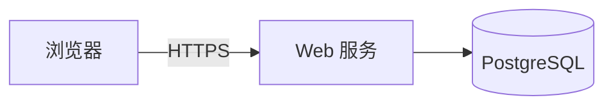

# 品类 9：完整应用与 Web 服务型 (Fullstack App) 完整模板

> 先读 [README 模板总纲](../readme-template.md) 的「前置事实清单」「通用底座 12 节」和「品类增量」表，再用本骨架。
> 只取与你项目相符的这一份，不要跨品类拼接。


````markdown
# 🌐 应用名称 / Web Service

<div align="center">

**现代化全栈 Web 应用 · 一键部署 · 开箱即用**

[](https://vercel.com/new/clone?repository-url=https://github.com/{owner}/{repo})
[](https://railway.app/template)

</div>

---

## 🚀 一键云端部署与 Docker

```bash
# Docker 运行
docker run -d -p 3000:3000 --env-file .env.production ghcr.io/{owner}/{repo}:1.2.3   # 固定版本号；勿用 latest（不可复现、回滚困难）

# Docker Compose
docker compose up -d
```

## ⚙️ 环境变量清单 (`.env.example`)

| 变量名 | 必填 | 默认值 | 说明 |
|---|---|---|---|
| `DATABASE_URL` | 是 | - | PostgreSQL 连接串（`docker compose logs db` 或云厂商控制台） |
| `SESSION_SECRET` | 是 | - | `openssl rand -hex 32`；多副本必须同值 |
| `PORT` | 否 | `3000` | 与反代一致即可 |

## 🧱 架构


<!-- alt：请求经 Web 服务落到数据库；当前无异步任务队列 -->

## 🔁 迁移、回滚与备份

```bash
docker compose exec app npm run migrate:up      # 升级
docker compose exec app npm run migrate:down    # 回滚一个版本
pg_dump "$DATABASE_URL" | gzip > backup.sql.gz  # 升级前必备份
```

## 🩺 健康检查与排障

| 现象 | 原因 | 处置 |
|---|---|---|
| 反代 502 + 日志 `connection refused 5432` | DB 未就绪或 URL 错 | 先 `docker compose up -d db`，再核对 `DATABASE_URL` |
| 登录后立刻被登出 | 多副本 `SESSION_SECRET` 不一致 | 统一为同一值 |
| 上传返回 413 | 反代 body 限制 | 调 `client_max_body_size` 或平台限制 |

健康检查：`curl -fsS localhost:3000/healthz` → `{"status":"ok","db":"up"}`

## 🚧 已知限制

- 单实例设计，多副本未做分布式锁；水平扩展前请读 `docs/scaling.md`
- 仅测试 PostgreSQL 16；MySQL **未验证**
- 无端到端加密，勿存放受限数据

## 🤝 支持 · 贡献 · 引用

卡住了？开 [Issue](../../issues) 或到 [Discussions](../../discussions) 提问；贡献前读 [CONTRIBUTING.md](CONTRIBUTING.md)。
````
